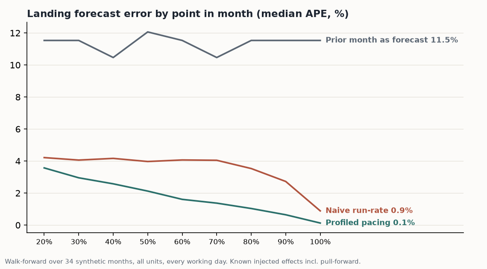

# Month landing forecast

Where does this month finish, given today? A daily-updating landing forecast
for revenue, built on working days and a pacing curve that re-learns every
month. Synthetic data with known injected effects, so the backtest can show
exactly what the engine catches and what it structurally cannot.



## Why it exists

Every commercial team has the 4pm question: are we landing this month or
not? The usual answers are a straight run-rate (month-to-date divided by
days elapsed, times days in month), which ignores that months load toward
their end, or last month's number, which ignores everything. This engine
answers it properly and says how wrong it tends to be at each point in the
month.

## Method

1. **Working days only.** Weekends and England bank holidays carry no
   revenue and no forecast weight. A month is its working days.
2. **The pacing curve.** For the trailing six completed months, compute the
   cumulative share of the month landed by each point in it, and average.
   Months load toward their end; the curve knows by how much, per unit.
3. **The landing forecast.** Month-to-date divided by the share the curve
   expects by today. It updates every working day, and because the curve is
   rebuilt each month from the trailing window, the forecast learns: a
   shift in seasonality or daily pattern feeds through within months.
4. **Benchmarks, always.** Naive run-rate and prior-month-as-forecast run
   alongside in the backtest. A method that cannot beat the naive answers
   is a decoration.

## Backtest

Walk-forward over 34 synthetic months (2024-01 to 2026-10), every working
day, all units summed. Median absolute percentage error by point in month:

| Elapsed | Profiled pacing | Naive run-rate | Prior month |
|---|---|---|---|
| 20% | 3.6% | 4.2% | 11.5% |
| 40% | 2.6% | 4.2% | 10.5% |
| 60% | 1.6% | 4.1% | 11.5% |
| 80% | 1.0% | 3.5% | 11.5% |

## What it cannot do, shown rather than hidden

The generator deliberately injects orders pulled forward ahead of an April
price increase: March loads late, April starts hollow. A pacing curve
cannot know an order was pulled forward; it can only notice that the pace
has broken from profile. The backtest prints the months it mis-read for
exactly this reason, and the honest operational answer is a flag a human
reads, not an automatic correction chasing its own tail.

This is also not a demand model. It forecasts where the month lands given
how it is pacing; it says nothing about why.

## Data

Synthetic, with known ground truth: trend, monthly and weekday seasonality,
month-end loading, holiday gaps and pull-forward events are all injected on
purpose (parameters at the top of `month_landing.py`), so recovery is
provable. Units are generic and configurable. The method class is standard
in parts and distribution businesses; this is a from-scratch rebuild on
public code and synthetic data.

## Run it

```
python3 -m venv .venv && .venv/bin/pip install matplotlib
.venv/bin/python month_landing.py
```
